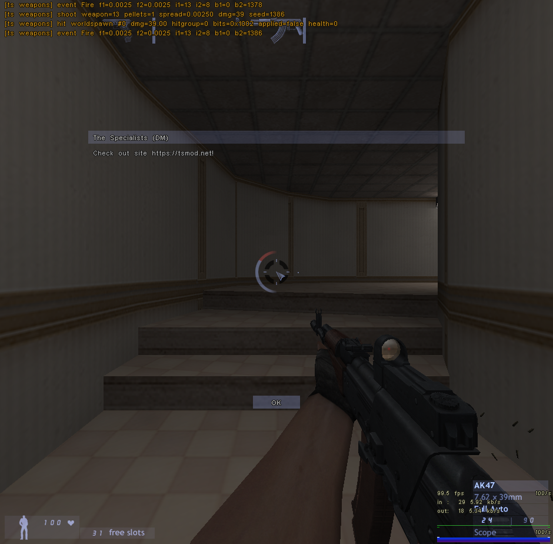

# The Specialists 3.0, in Rust

A Rust port of **The Specialists 3.0** (TS), the GoldSrc/Half-Life mod: both game libraries,
the server (`mp.dll` / `ts_i386.so`) and the client (`client.dll`). It's ported from the
decompilation in [the-specialists-decomp](https://github.com/CrunchyMonkies/the-specialists-decomp)
and is **wire-compatible with TS 3.0**: the original TS client can join this server, and this
client speaks the same protocol.

It runs on Xash3D FWGS, ReHLDS (pre-anniversary HLDS) and post-anniversary (HL25) Valve HLDS,
on Linux and Windows.



## Status

| Area | State |
|---|---|
| Player movement (shared, predicted) | The TS `pm_shared` port: ladders, water, duck, step-up, the TS jump, friction and acceleration, the `fuser1` time scale. 27 unit tests. |
| Stunts and animation | Dives, rolls, flips, cartwheels, wall jump and climb, slide and prone, super jump, bullet-time dodge. TS animation selection. |
| Weapons | All 37 TS weapons from the decoded tables. One shared `Gun` state machine for server and client prediction: fire modes, akimbo, burst, pump, zoom, attachments. Penetration, simulated bullets, grenades, thrown blades, kung fu with blocks, dropped guns, loadouts. |
| Game rules | DM, team DM, LMS, The One. Spawn selection, scoring and awards, power-ups (slow motion, slow pause, double fire rate, infinite clip, kung fu, health, armour, super jump), slow-motion propagation, chat, MOTD, the TS cvars, bots. |
| Map entities | 72 stock classnames with TS's changes (respawning breakables and doors, …) plus the TS entities. All 97 shipped maps load, and 88.8 % of map entities have a class. |
| Client HUD and UI | Every server message hooked. TS HUD in draw order, the loadout/buy menu, scoreboard, team select, MOTD, `ShowMenu`. TS input with `+alt1`/`+alt2`, the anti-script gate, and mouse look for FWGS and Steam GoldSrc. |
| Client view and effects | TS view (bob, client-side recoil, third person, slow-mo tint and fades), all 11 weapon events, the TS particle system and map emitters, lasers, flashlights, shadows. |
| Not yet | The TS split-bone studio renderer and motion-blur ghosts, map votes, HLTV director messages. Testing with a Steam GoldSrc client and real input (see [validation](docs/validation.md#32-not-validated)). |

Per-subsystem details, decomp mappings and gaps: [docs/implementation/](docs/implementation/).

## Quick start

Requirements: Rust (stable), `clang` (bindgen), MinGW-w64 for the Windows builds, and an
`xash3d-fwgs` checkout next to this repository (the bindings are generated from its headers, or
set `FWGS_DIR`).

```sh
rustup target add i686-unknown-linux-gnu i686-pc-windows-gnu x86_64-pc-windows-gnu
cargo xtask build --release      # all four targets
cargo xtask dist --release       # dist/<platform>/ts/: libraries + liblist.gam, gameinfo.txt, delta.lst
```

To play or host, copy `dist/<platform>/ts/` over a TS 3.0 install's `ts/` directory. Use the
`dist` output rather than raw `cargo build` DLLs: the xtask patches the Windows DLLs' export section
so Steam's engine can load them ([details](docs/validation.md#4-pitfalls-found-during-setup)).


| Platform | Server library | Client library |
|---|---|---|
| Linux, Steam HL / HLDS / ReHLDS | `dlls/ts_i386.so` and `dlls/ts.so` (stock HLDS loads the latter) | `cl_dlls/client.so` |
| Windows, Steam HL / HLDS / ReHLDS | `dlls/mp.dll` | `cl_dlls/client.dll` |
| Xash3D FWGS 64-bit | `dlls/ts_amd64.so` / `.dll` | `cl_dlls/client_amd64.so` / `.dll` |

Dedicated server, e.g. ReHLDS or HLDS on Linux:

```sh
./hlds_linux -game ts +maxplayers 16 +map ts_lobby
# bots: put `ts_bot_quota N` in ts/server.cfg (GoldSrc runs command-line +cvars before the
# game registers its cvars)
```

## Development and validation

`cargo xtask` installs into local engine roots (linking the TS content without modifying it) and
runs checks:

```sh
cargo xtask roots                        # fwgs, fwgs-win, rehlds-linux, rehlds-win, hlds25-linux, hlds25-win
cargo xtask install all
cargo xtask server rehlds-linux --map ts_awaken --bots 4 --seconds 60
cargo xtask client hlds25-win            # FWGS client joins that server; screenshot in target/
cargo xtask test                         # server check on every root
```

Setting up the roots (steamcmd, ReHLDS, Wine) and the latest results: [docs/validation.md](docs/validation.md).

## Documentation

| Doc | Contents |
|---|---|
| [docs/design.md](docs/design.md) | Goals, the wire-compatibility contract, architecture (server, client, shared), module ownership, build targets, deviations from TS |
| [docs/validation.md](docs/validation.md) | Engine roots and how to set them up, test commands, results, setup pitfalls |
| [docs/implementation/movement.md](docs/implementation/movement.md) | Player movement and stunts |
| [docs/implementation/weapons.md](docs/implementation/weapons.md) | Weapons, combat, wire formats |
| [docs/implementation/rules.md](docs/implementation/rules.md) | Game rules, power-ups, TS entities, HUD sync, bots |
| [docs/implementation/stock-entities.md](docs/implementation/stock-entities.md) | Half-Life map entities used by TS maps |
| [docs/implementation/client-hud.md](docs/implementation/client-hud.md) | Client input, HUD, menus |
| [docs/implementation/client-rendering.md](docs/implementation/client-rendering.md) | Client view, events, effects, prediction |
| [docs/implementation/integration.md](docs/implementation/integration.md) | How the packages were joined, decisions, unused API, known gaps |

## Origin

The workspace grew from [rust-hlmod](https://github.com/CrunchyMonkies/rust-hlmod), a minimal
GoldSrc mod in Rust. This repository keeps its history.
